# OSRIP premium redesign (branch `feature/premium-osrip-redesign`, November 2026)

The existing application, restyled and reorganised: no rebuild. The backend, database, API
contracts, calculations and data rules are unchanged, except for one addition: "Remember me"
(migration 0027).

This branch is **stacked on the platform upgrade** (`feature/osrip-platform-upgrade`, pull request
#4), which in turn sits on #2. No reference screenshots were attached to the request, so the
requested palette and structure are the reference. The identity is original to OSRIP.

## Colour palette and design tokens

All colours, radii, shadows, glass and chart colours are CSS variables in
`frontend/src/index.css`. Tailwind reads them through `@theme`. No component hard-codes a theme
colour. `npm run check:contrast` checks 47 text and control pairings in each theme, and all pass.

| Role | Light | Dark |
|---|---|---|
| Page | `#F7F3EE` warm ivory | `#101315` charcoal |
| Secondary band / card | `#EEE8E0` beige; cards `rgba(255,255,255,.78)` glass over `#FDFBF8` | `#191D20`; glass `rgba(255,255,255,.055)` |
| Accent (marks, rules, charts) | `#B9683F` / `#D99163` | `#F4A873` / `#D98A61` |
| Links and buttons | `#99532E` (a deeper shade of the accent, for 4.5:1) | `#F4A873` with dark text |
| Text / secondary text | `#292623` / `#655F5A` | `#F6F3EF` / `#A9AAA8` |
| Positive / warning / critical | `#287A5B` / `#9C6A1D` (text `#7A5216`) / `#B94C4C` (text `#A94141`) | `#72C6A1` / `#E4B765` / `#E67F7F` |

Where a requested colour is too light for small text on these surfaces, it is kept for marks,
rules and charts. A deeper shade of the same hue then carries the text. Both themes share the same
radii (0.5 to 1.375 rem), soft warm shadows, 18 px frosted glass and warm ambient light. People
who ask for reduced transparency get solid surfaces.

## Navigation

The sidebar follows the theme. Its modules open and close, and every module starts open; the
choice is remembered in the browser. A collapse button switches to an icon-only rail, with each
item's name in a tooltip on hover and keyboard focus, also remembered.

| Module | Items |
|---|---|
| Dashboard | Dashboard, Overview |
| Axes | Electricity, Water, Food Security, Trade |
| Research and Analytics | Analysis Workspace, Datasets, Scenarios, Forecasting, AI Research Assistant, Studies, Research library, Sources |
| Geographic Intelligence | Interactive Oman Map, Geographic Comparisons |
| Reports | Reports Dashboard, Saved Reports |
| Account | My Profile, Settings, Appearance, Language |
| Administration (only with the permission) | Data Management, Users and Roles, Groups and Permissions, Service Health, Audit Logs |

- **Current item:** items that open a section (`#scenarios`) or a tab (`?tab=groups`) are marked
  current only on that section or tab.
- **Profile:** a card at the foot shows the signed-in name and role, or "Sign in".
- **Search:** offers only pages the person may open.
- **Phones:** the same list sits in a drawer.

## Dashboard

- **KPI cards** for the four axes. Each shows:
  - the latest published value, its unit and a compact period ("Jan–Aug 2026 · Year to date");
  - the change against the same period one year earlier, with its direction. The colour is neutral
    on purpose, because a rise is not always good;
  - a sparkline of the same kind of period;
  - "Published in OSRIP" with a date.
  - With no published value, a card says "Data unavailable".
- **Analysis by axis:** an axis switcher, then:
  - a large area chart of the headline series over full years (from zero, with a readout and a
    data table);
  - the regional distribution with shares of the national total;
  - rule-based insights and data-quality notices from the decision brief;
  - quick links to Scenarios, Reports and the assistant.
- The photograph hero, the sector cards and the data rules stay.

## Sign-in

- **Layout:** a full-screen layout outside the application shell. Two slow, soft lights drift
  behind a centred glass card; under reduced motion they stay still.
- **Card:** the OSRIP mark, username or e-mail, a password field with a visibility toggle, and
  "Keep me signed in on this device".
- **Header:** language and theme controls.
- **No phone step:** no phone or WhatsApp verification is needed to sign in.
- **Remember me** (migration 0027, `user_session.persistent`):
  - unticked, the session cookie ends when the browser closes, and the server keeps its 8-hour
    and 30-minute idle limits;
  - ticked, the cookie and the server session last `OSRIP_SESSION_REMEMBER_DAYS` (default 14) on
    that device;
  - signing out ends it at once.
- **Administrator "Azzan":** created only with `ensure-admin`, with a temporary password typed at
  a hidden prompt and a forced change. See `docs/PLATFORM_UPGRADE.md`. Public registration never
  grants administration.

## AI assistant

- **Look:** replies sit in glass cards, the person's questions in soft accent bubbles, and the
  composer is frosted glass with a focus halo.
- **Unchanged behaviour:**
  - sources and evidence stay in the collapsed "Sources" panel under each reply;
  - evidence, hypotheses and assumptions keep their labels;
  - streaming, progress and retry work as before.
- **OpenAI:** not configured on this machine, so not tested live. Without an AI service the
  assistant answers with a record lookup labelled "Not AI-generated".

## Oman map

- **Relief:** a hillshade from the open Terrain Tiles (Mapzen; SRTM on land, ETOPO1 under the sea,
  credited on the map). It shades Al Hajar, Dhofar and the sea floor.
- **Basemap:** follows the theme (OpenFreeMap Positron or Dark), unless `VITE_MAP_STYLE_URL`
  names a style.
- **Shading:** a warm sequential ramp; "No data" is a separate neutral grey.
- **Boundaries:** all 11 governorates and 63 wilayats from OpenStreetMap, as in #4.

## Tables, charts and administration

- **Data table** (`components/ui/data-table.tsx`): search, sortable columns, paging, an explained
  empty state and CSV export of the filtered rows. First used for the new **Audit Logs** page (the
  latest 500 audit events, filterable by area).
- **Charts:** the dashboard trend chart and the sparklines use the theme's chart tokens. The
  existing charts take the new palette through the same tokens.
- **Administration:** Users, Roles and Groups, Service Health, Data Management and Reports keep
  their behaviour and take the new surfaces.

## Screenshots

Light and dark, 1440 × 900, signed in as a throwaway test administrator on a copy of the
development database (real verified data):

| Page | Light | Dark |
|---|---|---|
| Sign-in | 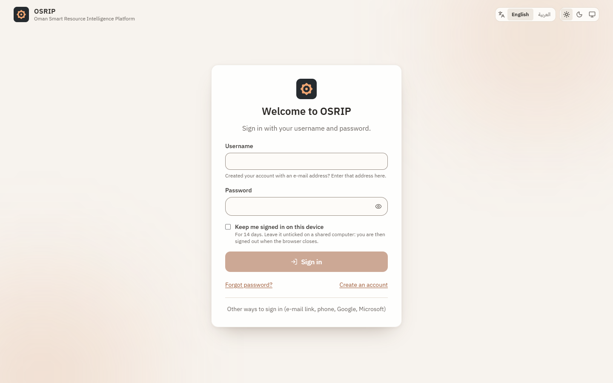 | 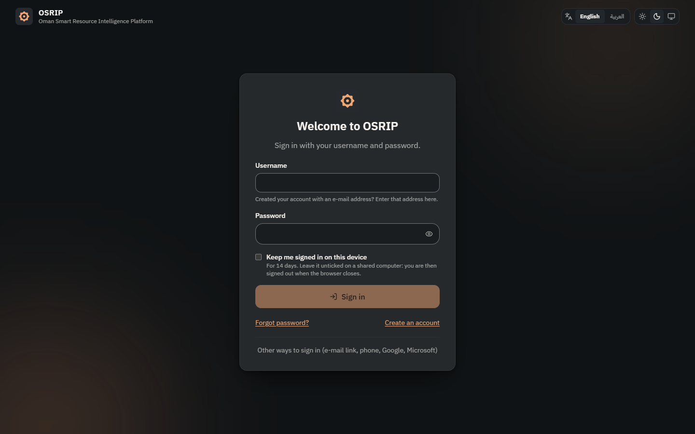 |
| Dashboard | 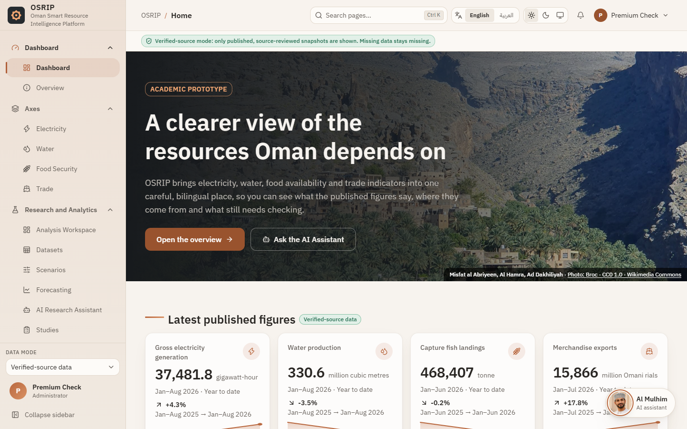 | 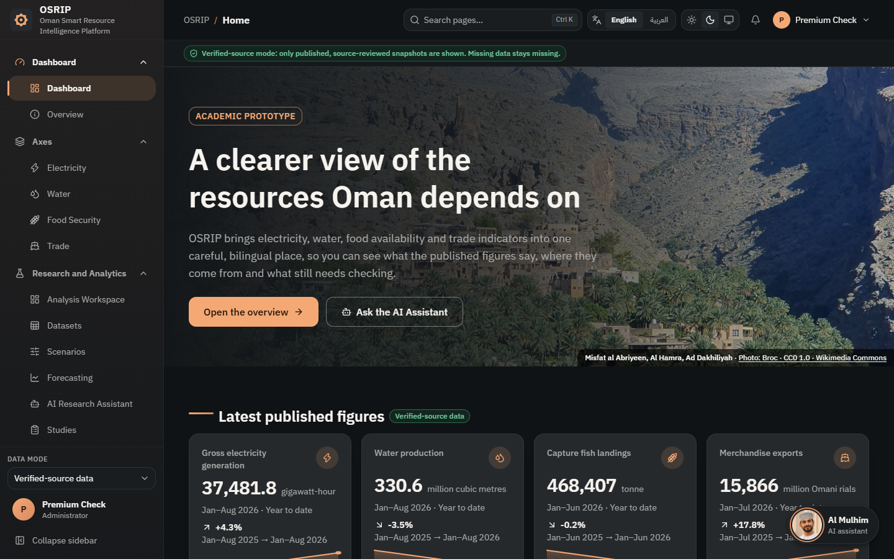 |
| Analysis by axis | 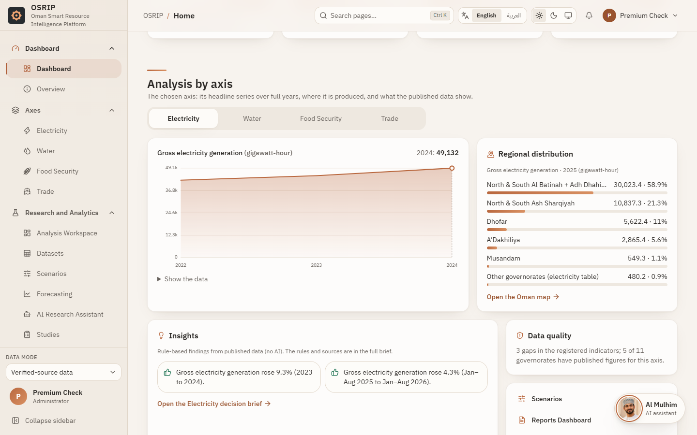 | 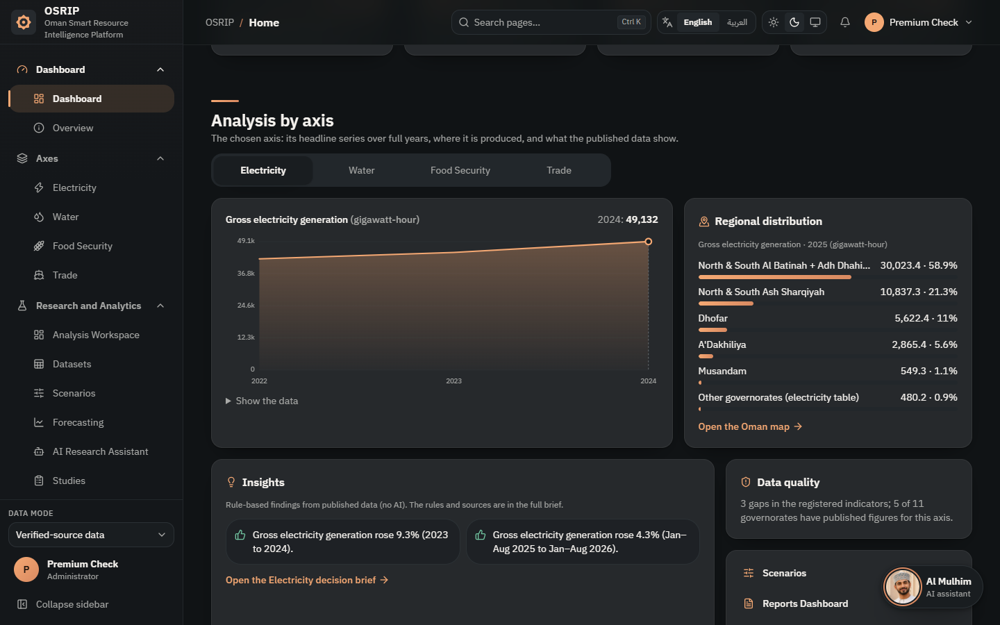 |
| Decision brief | 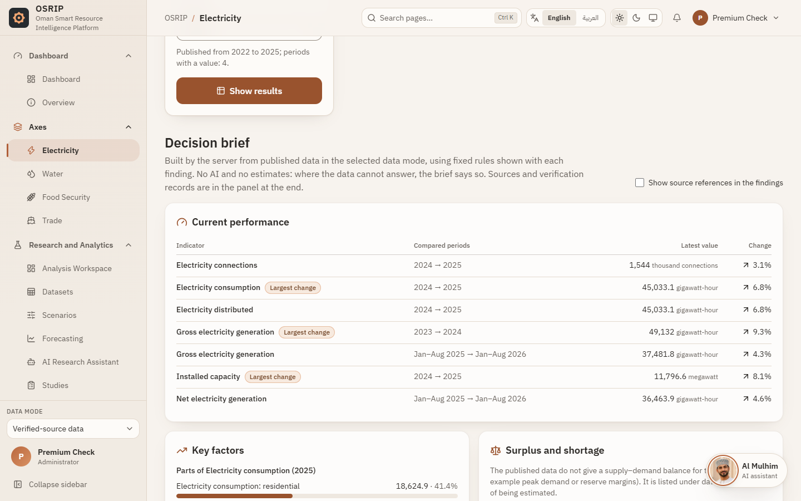 | 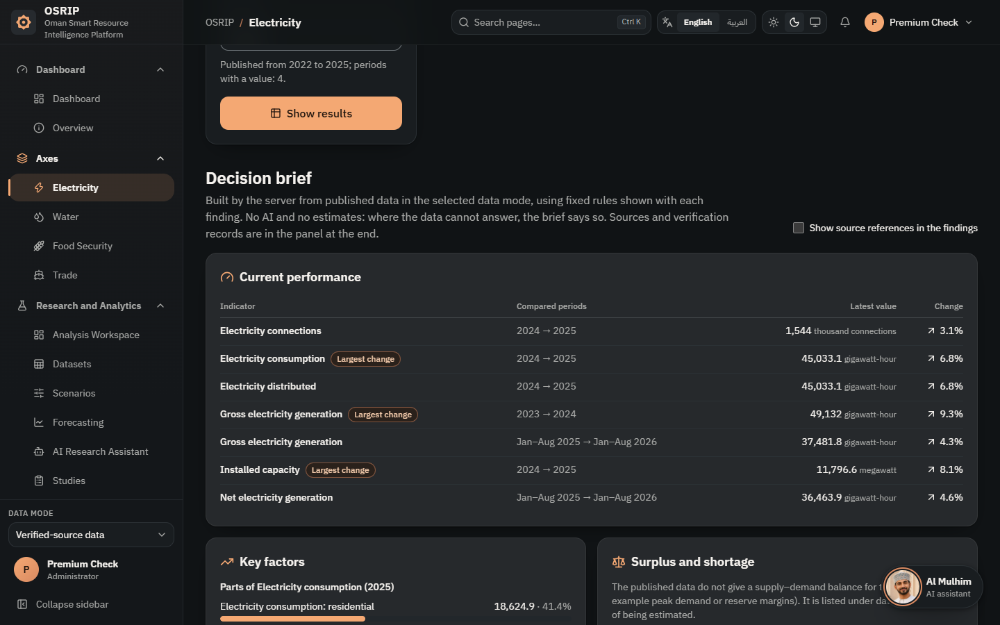 |
| Oman map | 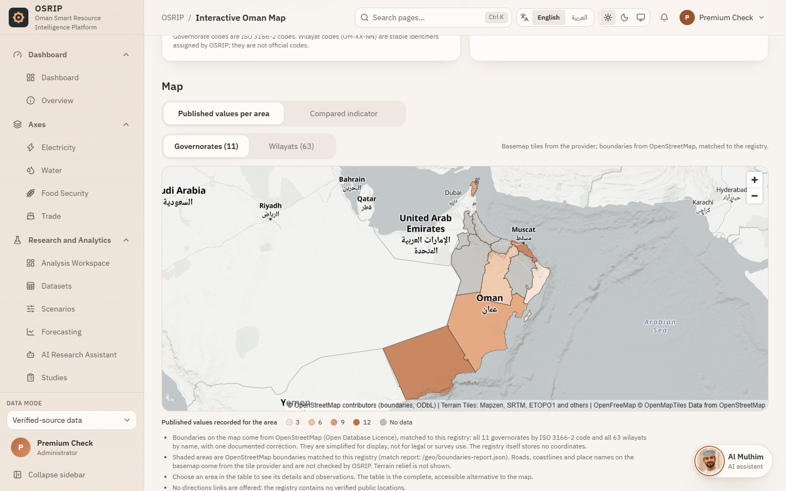 | 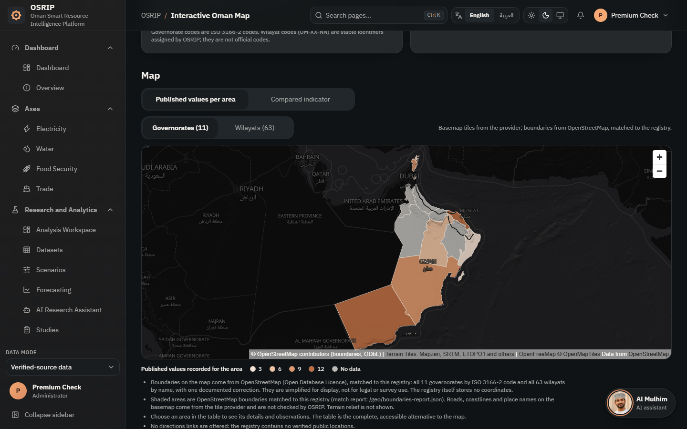 |
| Service Health | 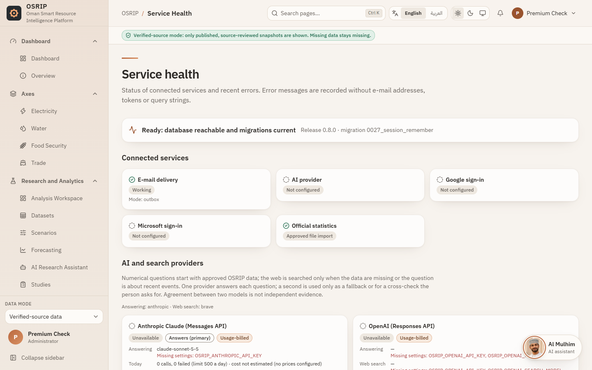 | 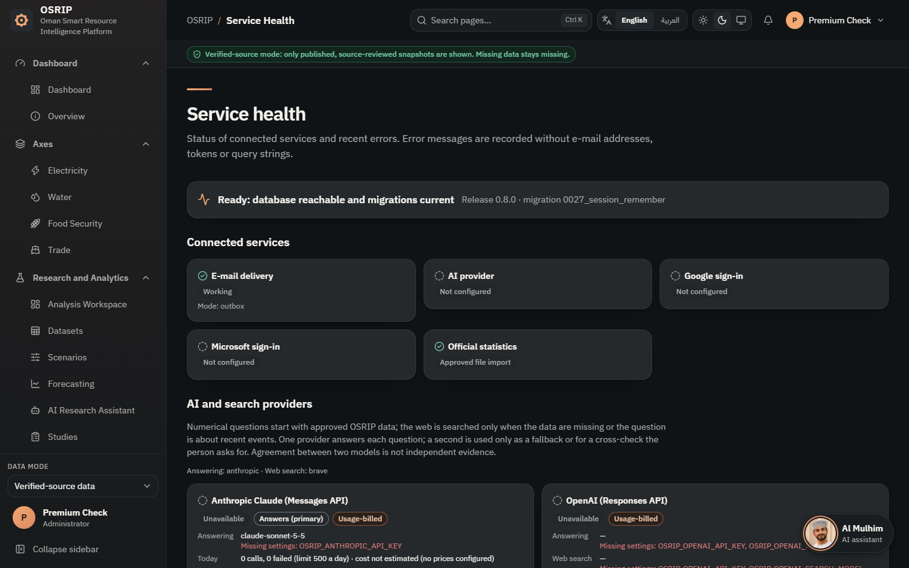 |
| Audit Logs | 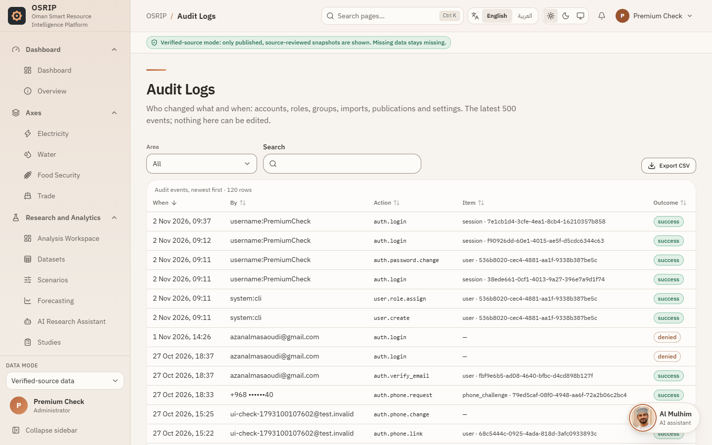 | 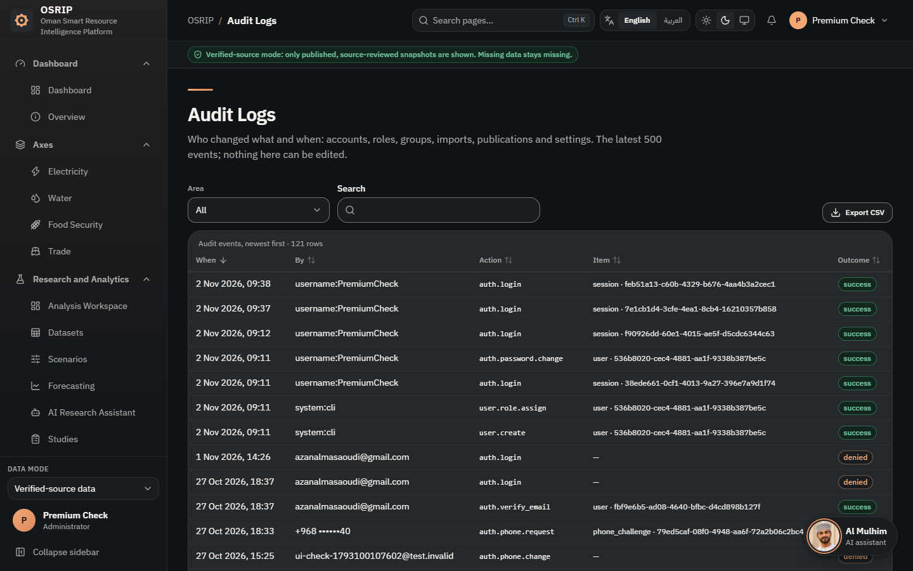 |

Phone, Arabic: 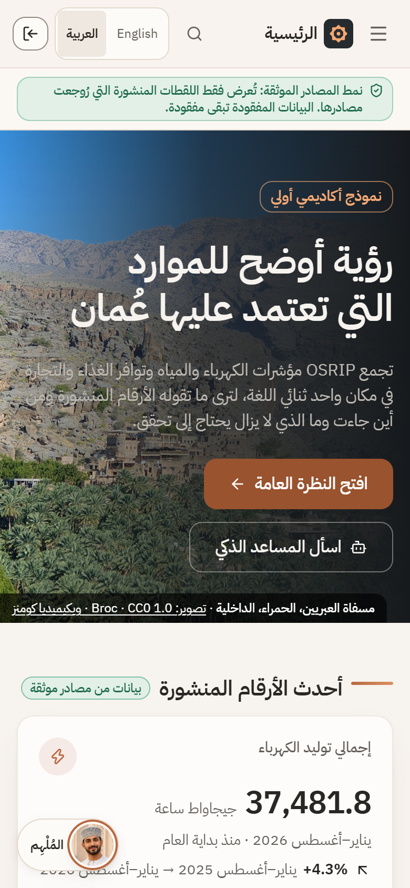

## Limitations and next steps

- **OpenAI:** live calls are untested until a key is configured.
- **Remaining tables:** the new data table is used for the audit log only. The existing tables
  (datasets, imports, comparisons) keep their own controls and could adopt it next.
- **Reports:** no separate "Export Center" page. Exports (PDF, Excel, CSV) stay on each report.
- **Notifications:** the bell is the existing control. No new notification service was added.
- **Theme choice "System":** it follows the device when the page loads or the choice is made, but
  the map's basemap only switches on the next theme change.
